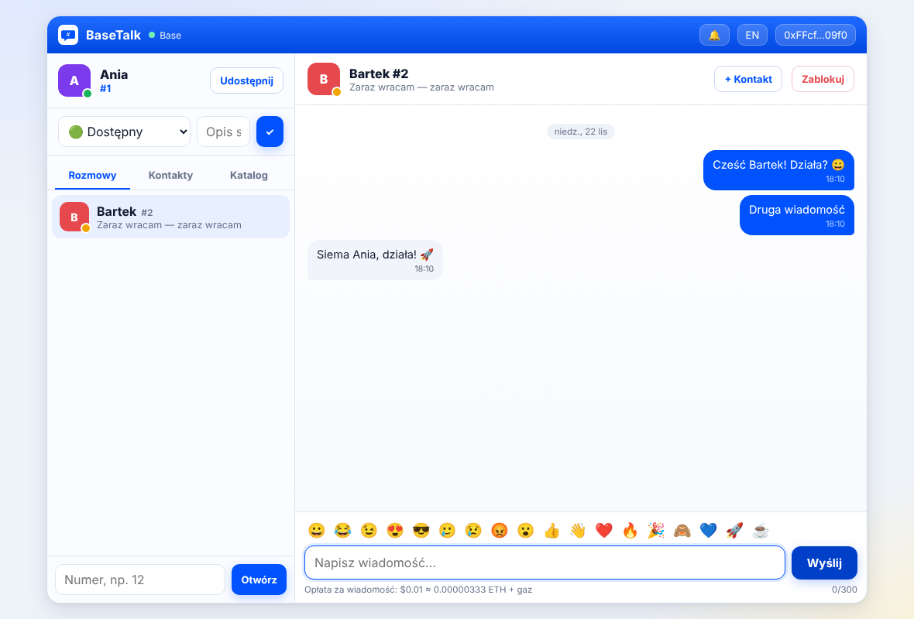
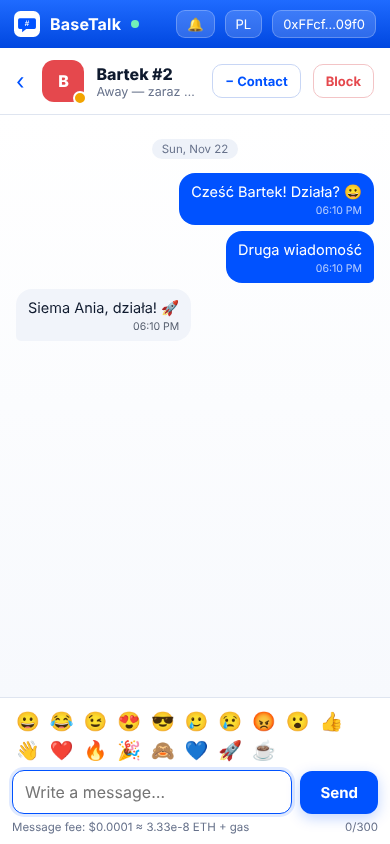

# BaseTalk — Base Network Messenger 💬

**On-chain messenger on Base network** (Base L2, Coinbase) — classic numbered chat in the spirit of old-school IM apps.
**Komunikator na sieci Base** — czat z numerkami, wiadomości zapisane na blockchainie.

👉 **Live app: https://0xdonaldjtrump.github.io/basetalk/**

**Contract on Base:** [`0x0092fc52A827059F560FDA59b11b1DE7Bf41a056`](https://basescan.org/address/0x0092fc52A827059F560FDA59b11b1DE7Bf41a056)

## Screenshots
| Desktop | Mobile |
|---|---|
|  |  |

## How it works
- **$1 once** — you get your own number (#1, #2, #3 …) forever
- **$0.01 per sent message**
- Reading, contacts, status, directory — free (gas only)
- Connect with MetaMask, Coinbase Wallet or any EVM wallet on Base
- Fees are priced in USD and paid in ETH (Chainlink ETH/USD oracle on Base, with a backup price)
- Status (available / away / busy / invisible), contact list, user directory, blocking, unread badges with sound, emoji, PL/EN

## Jak to działa (PL)
- **$1 jednorazowo** — dostajesz własny numer na zawsze
- **$0.01 za wysłaną wiadomość**, czytanie za darmo
- Logowanie portfelem (MetaMask, Coinbase Wallet) na sieci Base

## Files
- `index.html` — the whole dApp (static, hosted on GitHub Pages, ethers.js v6)
- `BaseTalk.sol` — the Solidity smart contract (Solidity 0.8.24, optimizer 200 runs)

> ⚠️ Messages are stored on a public blockchain — anyone can read them on a block explorer. Don't send private data.

**Keywords:** Base network messenger, Base chain chat, onchain messaging, web3 chat, decentralized messenger, Base dApp, crypto messenger, wallet-to-wallet chat, komunikator Base.
